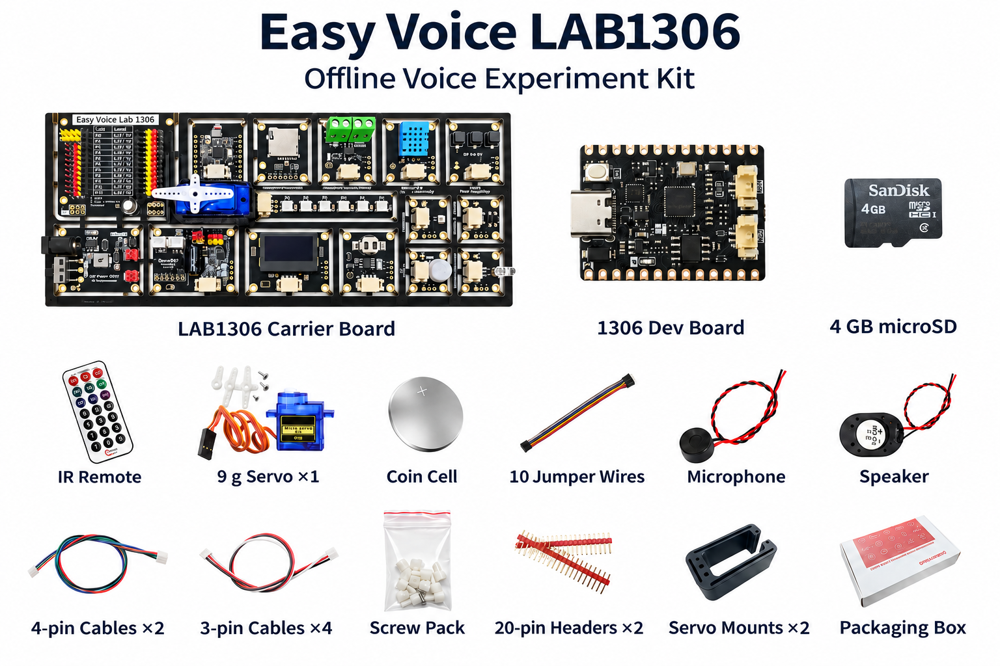

# Easy Voice LAB1306 Experiment Kit

The Easy Voice LAB1306 is a modular electronics lab for offline voice control. The CI1306 controller recognizes configured commands on the device. The carrier board lets you connect those commands to lights, displays, sensors, infrared, and motion.

## Start here

1. Follow the [quick start](docs/quick-start.md) to connect the controller, flash a demo, and control its onboard LED.
2. Use the [hardware guide](docs/hardware.md) to identify modules, check pin assignments, and choose a power source.
3. Pick a project from the [experiment guide](docs/experiments.md).

## Hardware at a glance

| Area | Hardware |
| --- | --- |
| Voice and audio | Easy Voice 1306 controller with CI1306, microphone and speaker connections, USB serial for firmware upload |
| Display and lighting | 0.96-inch 128 × 64 I²C OLED and six addressable WS2812 RGB LEDs |
| Inputs | Three buttons, ambient light sensor, DHT11 temperature and humidity sensor, and PIR motion sensor |
| Time and storage | PCF85063A real-time clock and SPI microSD slot |
| Communication | ESP32-C3 Wi-Fi module connected over UART, plus IR transmit and 38 kHz receive |
| Outputs | Low-voltage DC solid-state relay, two DC motor channels, and four servo outputs |

[View the LAB1306 listing on Tindie](https://www.tindie.com/products/johnson/easy-voice-lab1306-offline-voice-experiment-kit/).

This guide is an English adaptation of the [LAB1306 project notes by mostfun01](https://arduino.me/a/3375). The artwork is localized from the kit materials, and the AilyBlockly illustrations explain the workflow. Refer to the hardware tables and your board revision when wiring.
