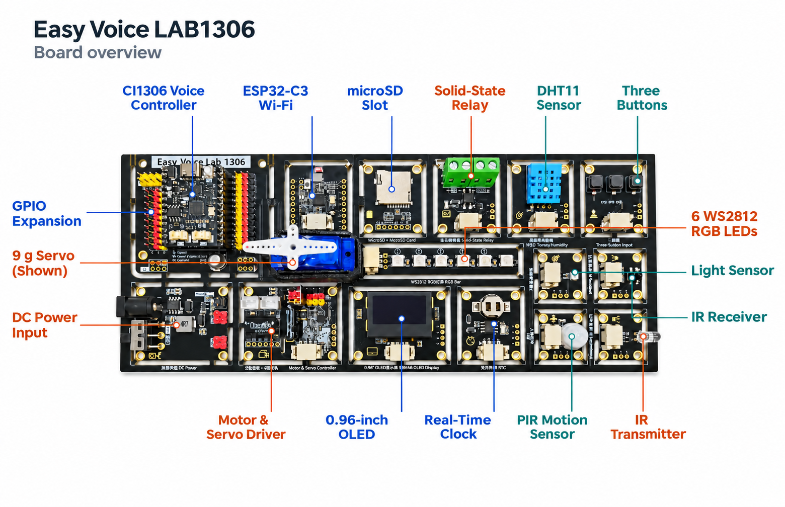
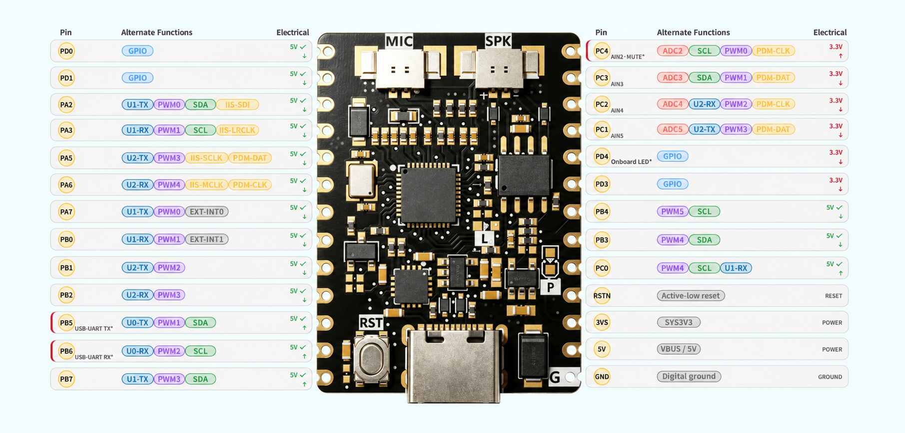

# Hardware reference

The LAB1306 carrier routes the CI1306 controller's GPIO, ADC, PWM, I²C, SPI and UART to onboard peripherals. Several modules can be separated along the designed board sections and reused through their G/V/S or dedicated connectors. Power down before separating modules, check each module's pin order and power requirements, and insulate the exposed edges before mounting.

## Controller header

The illustration shows alternate functions of the development board. The table gives the **default wiring on the LAB1306 carrier**, so an alternate function shown in the figure may already share a pin with an onboard module. The header is 2 × 13 pins.

| Pin | Carrier connection | Default use |
| --- | --- | --- |
| PD0 | SD_SCK | microSD SPI clock |
| PD1 | SD_MOSI | SPI data from controller to microSD |
| PA2 | IR_T | IR transmitter PWM or carrier |
| PA3 | PIR | Motion sensor digital input |
| PA5 | GPIO | Expansion |
| PA6 | WS2812 | RGB LED data |
| PA7 | SD_MISO | SPI data from microSD to controller |
| PB0 | IR_R | Demodulated 38 kHz IR receiver output |
| PB1 | ESP_RX | Controller TX to ESP32-C3 RX |
| PB2 | ESP_TX | Controller RX from ESP32-C3 TX |
| PB5 | USB_TX | UART0 TX, reserved during USB upload |
| PB6 | USB_RX | UART0 RX, reserved during USB upload |
| PB7 | RELAY | Solid-state relay control |
| PC4 | GPIO / ADC2 | Expansion |
| PC3 | BUTTON | Three buttons share one ADC input |
| PC2 | LIGHT | Analog ambient light input |
| PC1 | SD_CS | microSD SPI chip select |
| PD4 | GPIO | Expansion, also used for the controller LED on applicable revisions |
| PD3 | DHT11 | Temperature and humidity data |
| PB4 | I2C_SCL | Shared OLED, RTC, and HC32 clock |
| PB3 | I2C_SDA | Shared OLED, RTC, and HC32 data |
| PC0 | GPIO / UART1 RX | Expansion |
| RST / RSTN | RESET | Active-low controller reset |
| 3V3 | SYS3V3 | Controller 3.3 V rail |
| 5V | SYS_5V | Controller 5 V system rail |
| GND | GND | Common digital ground |

Use 3.3 V logic with carrier peripherals and expansion modules. **PC1–PC4, PD3 and PD4 are 3.3 V only.** Where the controller chart marks an input as 5 V tolerant, that rating applies to input tolerance. The controller still outputs 3.3 V logic. Check the connector labels before applying power. Stop actuators before updating firmware. Keep CI1306, HC32 and ESP32-C3 firmware and tools separate.

## Power and external loads

| Power mode | Use it for | Motor rail (VM) |
| --- | --- | --- |
| USB only | Firmware upload, basic sensors and OLED, low-power experiments | Unpowered |
| External DC only | Tests that need the actuator supply | Powered from DC |
| USB and external DC | Firmware and serial debugging with the actuator supply available | Powered from DC only |

The carrier routes USB and external DC into its logic supply through separate diode paths. Follow the input rating and polarity printed on your board. The carrier's 5 V system rail and its external DC input are separate connections. Use a suitable external DC supply when running motors or servos. Begin with the actuator unloaded and keep moving linkages clear. Disconnect power if a motor stalls or the board heats unexpectedly.

The GAQY212GSX relay is for suitable **low-voltage DC** loads within the hardware ratings. Keep mains AC away from the board. The motor and servo module uses an HC32L110C6UA controller over the shared I²C bus to provide two DC motor channels and four servo outputs.

Disconnect power before inserting or removing the controller, microSD card, RTC battery, or external loads. Work on a dry, nonconductive surface.

[Quick start](quick-start.md) · [Experiments](experiments.md) · [Back to README](../README.md)
