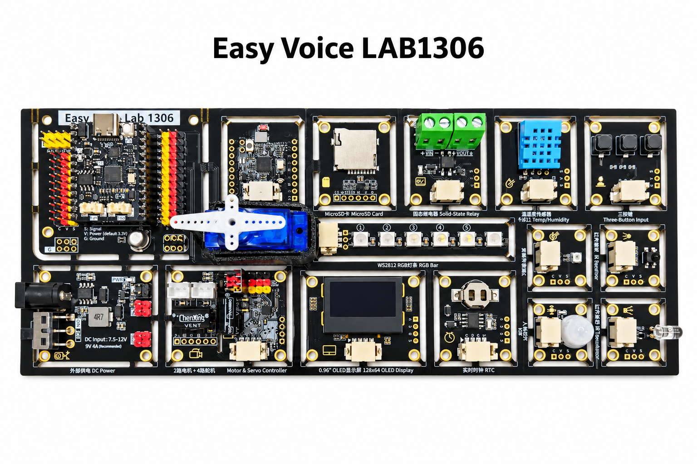
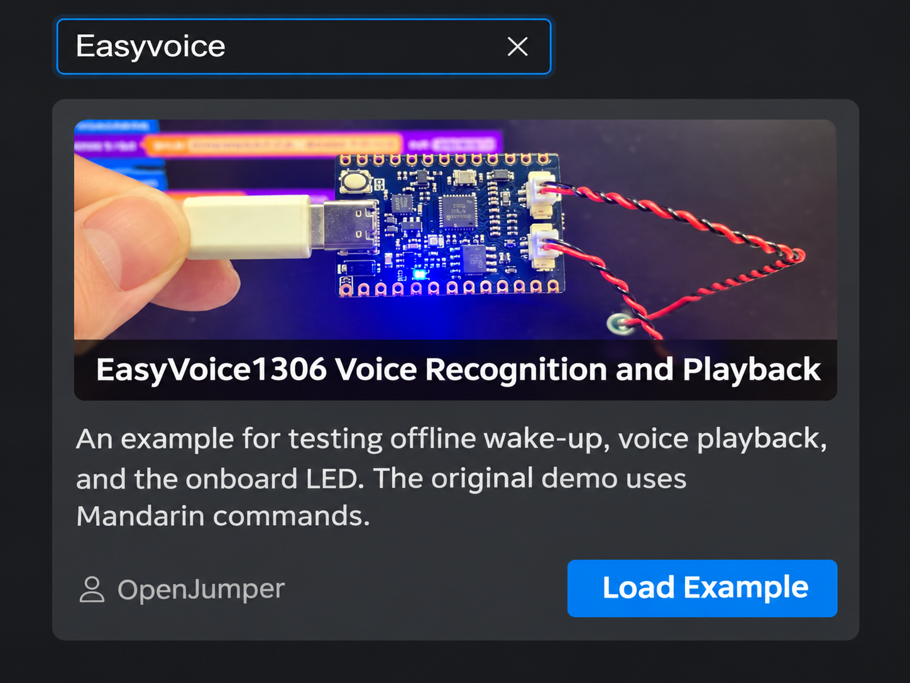
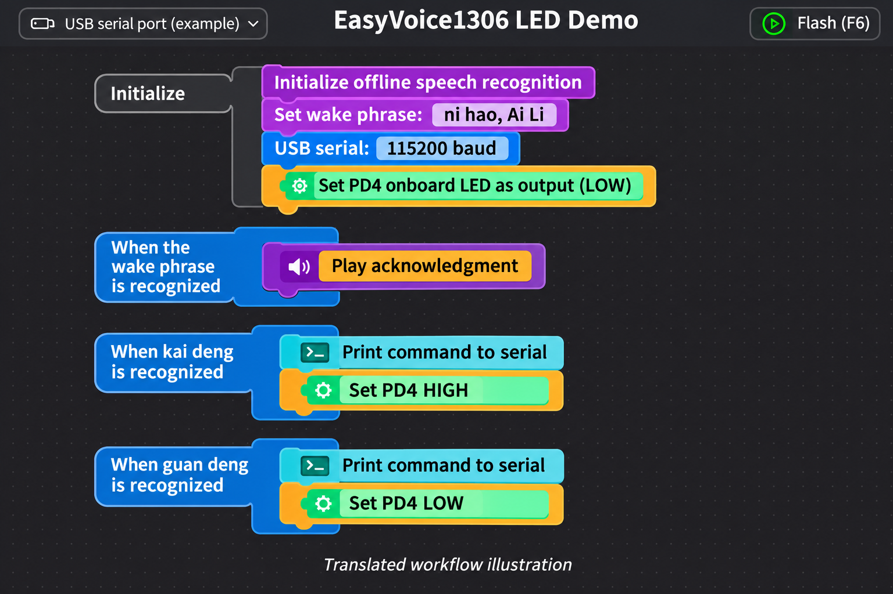

# Quick start

Start with the controller and USB power. Once the LED demo works, move on to the carrier board peripherals.

## 1. Fit the controller

- Disconnect power. Line up both rows of headers with the carrier socket before pressing the Easy Voice 1306 controller into place.
- Face the controller's USB port outward, following the carrier layout. Make room for the USB cable beside the DC input.
- Leave motors, servos and relay loads disconnected for the first boot. Connect a USB **data** cable and check that the computer detects a serial port.

The photo shows a servo fitted for demonstration. Leave it disconnected for the USB-only check.

## 2. Load the AilyBlockly demo

1. Install [AilyBlockly](https://yiyu.pro/download). The publisher has a [basic usage guide](https://yiyu.pro/doc/basic-usage-guide).
2. Select **Easy Voice LAB1306** when creating a project. Open the example gallery and search for **Easyvoice**.
3. Load the EasyVoice1306 voice recognition and playback example. It may appear under its Mandarin title **EasyVoice1306 语音识别播报例程**. Verify the target board after loading the example.
4. Select the USB serial port that appeared when you connected the board, then choose **Flash** (F6 in the illustrated version). Keep external devices from driving PB5 and PB6 during upload.

The figures are English illustrations. Your AilyBlockly version and interface language may show different labels.

## 3. Test the demo

The documented example uses the following **Mandarin** phrases. The English meanings help you understand the demo. Recognition follows the phrases configured in the firmware.

| Say | Pinyin | Expected behavior |
| --- | --- | --- |
| 你好，艾丽 | nǐ hǎo, Àilì | Wake the demo. The speaker responds if connected and enabled. |
| 开灯 | kāi dēng | Set the onboard LED output high and print the command to serial. |
| 关灯 | guān dēng | Set the onboard LED output low and print the command to serial. |

Open the serial monitor at **115200 baud** for this example. Confirm the LED behavior against your controller revision and check the PD4 marking. The CI1306 handles recognition on-device. AilyBlockly account and network requirements for optional services are separate from the board's voice processing.

If the port does not appear, try a known data cable. If flashing fails, close other software using the port, check the target board, and disconnect external circuits from PB5/PB6. If speech does not trigger an action, start with the configured wake phrase and look for serial output before testing the LED.

[Hardware and power](hardware.md) · [Experiments](experiments.md) · [Back to README](../README.md)
